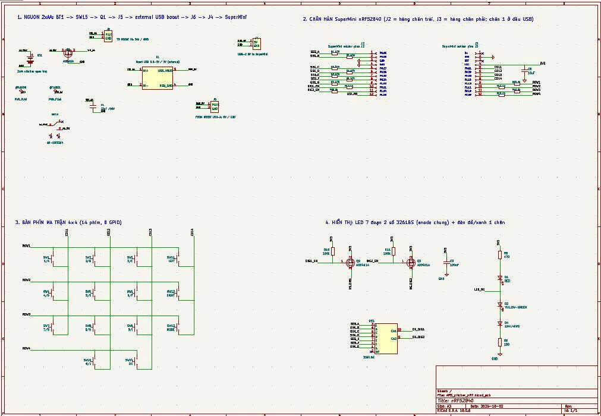
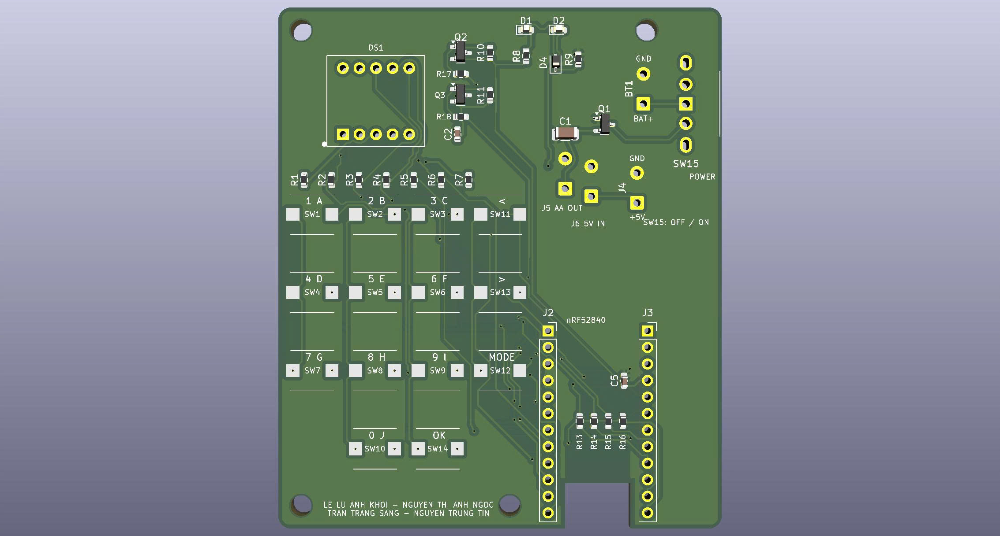
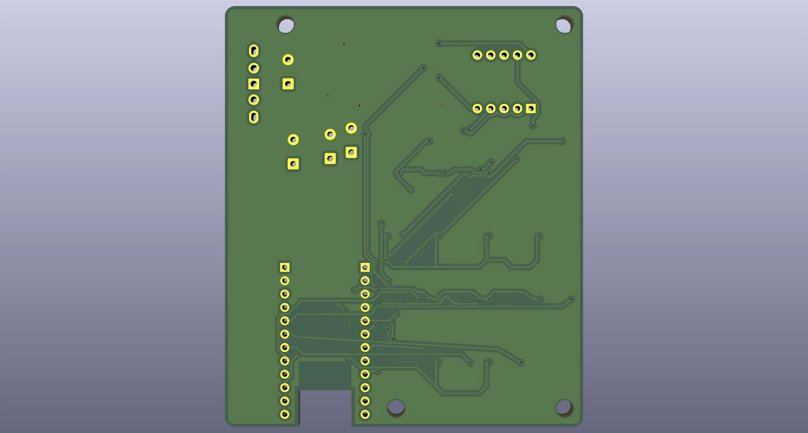

# Project_IOT_clicker — Hệ thống phản hồi lớp học dùng Remote nRF52840 (ARS)

Báo cáo môn học **IoT (IOTS337929)**, Nhóm 2, Bộ môn Cơ điện tử, Khoa Cơ khí, Trường Đại học Công nghệ Kỹ thuật TP.HCM, tháng 10/2026.

**ARS (Audience Response System)** là hệ thống hỏi–đáp trên lớp:
- Mỗi học sinh có một **Remote nRF52840** do nhóm tự thiết kế mạch.
- **Laptop giáo viên** vừa là máy chủ, vừa dùng Bluetooth sẵn có để thu đáp án, không cần thiết bị trung gian.
- Kết quả hiện ngay trên bảng điều khiển và màn chiếu, đồng thời được lưu lại để học sinh và phụ huynh xem trên web.
- Một **máy chủ Cloud 24/24** được laptop tự đồng bộ, để học sinh và phụ huynh dùng ở nhà.

📄 Báo cáo đầy đủ: [docs/bao-cao/Bao_cao_IOT_nhom2.docx](docs/bao-cao/Bao_cao_IOT_nhom2.docx)

---

## Cấu trúc thư mục

```
Project_IOT_clicker/
├── hardware/          Mạch Remote: dự án KiCad (sơ đồ nguyên lý, PCB 2 lớp 68×80 mm, thư viện ký hiệu/footprint,
│   ├── kicad/         Gerber prototype), bảng linh kiện BOM, ảnh sơ đồ và mạch in
│   ├── images/
│   └── BOM_linhkien_nhom2.xlsx
├── firmware/          Firmware Remote nRF52840 (Arduino, Adafruit nRF52 core 1.7.0)
│   └── ARS_remote_v3_17/   ← bản đang dùng (BLE advertising A6, LE 1M); các thư mục khác là phiên bản cũ / dự phòng GATT
├── server/            Phần mềm máy chủ phía Bluetooth (Python 3)
│   ├── bridge/        Bộ thu Bluetooth: ble_adv.py (đang dùng), adv_protocol.py, adv_phy.py (LE 1M); ble_gatt.py, ble_scan.py, bridge.py (dự phòng)
│   ├── ingest/        Bộ xử lý gói: ingest_adv.py (đang dùng), ingest.py (luật nghiệp vụ)
│   ├── common/        Đọc cấu hình, kết nối CSDL
│   └── history/       Bộ thu các phiên bản cũ
├── database/          MariaDB: schema.sql + migration 002–017
├── web/               Ứng dụng web PHP 8: cổng giáo viên, học sinh, phụ huynh, quản trị; API JSON; đồng bộ Cloud
├── deploy/            Cài đặt Ubuntu (install_ubuntu.sh, --cloud), dịch vụ systemd, nâng cấp/hoàn tác V3.16→V3.18, lệnh `ars`
├── tests/             Kiểm thử web (830 kiểm tra), giao thức quảng bá, LE 1M, firmware chạy giả lập trên máy tính
├── tools/             Đo 100 lần gửi, đo độ trễ, phân tích trace HCI, giả lập nhiều Remote
├── docs/              Tài liệu
│   ├── bao-cao/       Báo cáo môn học (Word)
│   ├── huong-dan-su-dung/  Hướng dẫn cho giáo viên, học sinh, phụ huynh, lập trình viên
│   ├── phien-ban/     Ghi chú từng phiên bản (START_HERE_*, UPGRADE_*, CHANGES_*), báo cáo hợp nhất V3.18 + Cloud
│   ├── HUONG_DAN_CAI_DAT.md · HUONG_DAN_CLOUD.md · HUONG_DAN_NGUOI_MOI.md · TONG_HOP_DU_AN.md
│   ├── KY_THUAT_CHI_TIET.md   Kiến trúc, luồng dữ liệu, giao thức (chi tiết kỹ thuật)
│   └── GATT_PROTOCOL_V3_11.md · BLUEZ_REQUIRED_CONFIG.md · ARS_BLE_Project_Handover.md
├── samples/           Đề thi mẫu (5 bộ × 20 câu: CSV/XLSX/DOCX), file mẫu nhập liệu
└── config.ini.example Cấu hình mẫu (DB, MQTT, Bluetooth)
```

## Kiến trúc

```
 TRÊN LỚP (laptop giáo viên, chạy offline)                                         Ở NHÀ (24/24)
 ┌──────────┐ BLE advertising ┌────────────────┐  MQTT  ┌────────────────┐  SQL  ┌─────────┐   tự đồng bộ   ┌───────────┐
 │ Remote   │ A6, LE 1M ─────▶│ Bộ thu BLE     │──────▶│ Bộ xử lý gói    │──────▶│ MariaDB │──── 3 phút ───▶│ ARS Cloud │◀── học sinh,
 │ nRF52840 │◀── STATE, KẾT QUẢ│ ble_adv.py     │◀──────│ ingest_adv.py   │◀──────│         │   (HTTPS JSON)  │ (Oracle + │    phụ huynh
 └──────────┘   (token 64 bit)└────────────────┘ Mosquitto└────────────────┘       └────▲────┘                 │ Tailscale)│
                                                                                       │                      └───────────┘
                                                              Web PHP (Apache) ────────┘ ◀── giáo viên, màn chiếu, học sinh, phụ huynh
```

Remote và bộ thu **chỉ truyền/nhận**. Mọi kiểm tra hợp lệ nằm ở bộ xử lý gói, nên muốn đổi luật chỉ cần sửa máy chủ, không phải nạp lại hàng chục Remote.

## Phần cứng Remote

Mạch 2 lớp 68×80 mm thiết kế bằng KiCad, gồm module nRF52840 SuperMini, bàn phím ma trận 14 phím, LED 7 đoạn 2 chữ số, đèn đỏ/xanh và nguồn 2 pin AA. File gốc nằm trong [hardware/kicad/](hardware/kicad/), Gerber trong [hardware/kicad/gerber_prototype/](hardware/kicad/gerber_prototype/), danh sách linh kiện trong [hardware/BOM_linhkien_nhom2.xlsx](hardware/BOM_linhkien_nhom2.xlsx).

**Sơ đồ nguyên lý**



| PCB mặt trên | PCB mặt dưới |
|:---:|:---:|
|  |  |

## Tính năng chính

| Khối | Tính năng |
|---|---|
| **Phần cứng** | Bo 2 lớp 68×80 mm; bàn phím ma trận 14 phím; LED 7 đoạn 2 số; đèn đỏ/xanh; 2 pin AA qua tăng áp, MOSFET chống ngược cực. Chi phí linh kiện ≈ 217.000 đ/Remote |
| **Firmware V3.17** | Nhập room/ID; điểm danh; chọn đáp án A–J; tự theo câu giáo viên đang chiếu, khoá khi câu đóng; tắt LED sau 30 giây; mỗi lần gửi là một giao dịch có token, gửi lại tối đa 6 lần |
| **Truyền không dây** | BLE advertising không kết nối (gói A6 21 byte), STATE/KẾT QUẢ ngược lại; laptop tắt Coded PHY để dùng LE 1M; đo 1 Remote: trung vị 597 ms, p95 1,17 s |
| **Máy chủ** | 10 bước kiểm tra kèm mã lý do từ chối; lưu kết quả giao dịch cùng đáp án trong một giao dịch CSDL (gửi lại không ghi trùng); tự đóng câu hết giờ |
| **Web giáo viên** | Lớp và danh sách học sinh (nhập Excel/CSV/Word/TXT); soạn câu từ Word/Excel/PDF/PowerPoint, công thức toán, trộn đề; bảng điều khiển và màn chiếu thời gian thực; **điểm danh tự động**; kết quả theo câu (p, D) và học sinh; xuất Excel/CSV; bài giảng; bài tập về nhà (AI gợi ý chấm); thi đua; **cấp tài khoản phụ huynh theo SĐT** |
| **Web học sinh** | Đăng nhập MSSV; ôn tập, sổ câu sai; bài tập về nhà (tệp, ảnh, ghi âm); bài giảng; thi đua; trợ lý học tập AI |
| **Web phụ huynh** | Đăng nhập bằng SĐT (bắt buộc đổi mật khẩu lần đầu) hoặc mã mời; **thông báo điểm danh và điểm sau mỗi buổi**; chuyên cần, tiến độ, kiến thức còn yếu, nhận xét |
| **Quản trị** | Giáo viên đăng ký trước, nhập mã mời sau (quản trị viên duyệt); trường và lớp hành chính; cấu hình AI, Zalo/SMS |
| **Cloud** | Máy chủ 24/24 (Oracle Cloud Always Free + Tailscale Funnel); laptop tự đồng bộ một chiều mỗi 3 phút, thử lại khi mất mạng |

## Công nghệ

- **Phần cứng:** nRF52840 SuperMini (ARM Cortex-M4F, BLE 5.0), KiCad.
- **Firmware:** Arduino C++, Adafruit nRF52 core (Bluefruit), SoftDevice, FreeRTOS.
- **Sóng:** BLE advertising, LE 1M PHY.
- **Bộ thu:** Python 3, bleak, dbus-fast, BlueZ / D-Bus, Bluetooth MGMT API.
- **Truyền tin nội bộ:** MQTT (Mosquitto, paho-mqtt, MQTT qua WebSocket).
- **CSDL:** MariaDB (InnoDB, VIEW).
- **Web:** PHP 8 (không framework), Apache, JavaScript thuần, KaTeX, mã QR, xuất Excel/Word, đọc PDF (poppler).
- **AI:** Anthropic Claude, Google Gemini, OpenAI, có chế độ Cơ bản không cần Internet.
- **Đăng nhập:** OAuth 2.0 Google.
- **Cloud và vận hành:** Oracle Cloud, Tailscale Funnel, Avahi mDNS, systemd, Ubuntu.
- **Kiểm thử:** Python unittest, requests, BeautifulSoup, g++.

## Cài đặt nhanh

**Laptop lớp học mới (Ubuntu 22.04 / 24.04)**
```bash
sudo bash deploy/install_ubuntu.sh                 # web, CSDL, MQTT, dịch vụ; mở http://ars.local/gv
# chuyển sang truyền quảng bá V3.18 (theo thứ tự, mỗi bước có sao lưu + hoàn tác):
sudo bash deploy/install_gatt.sh && sudo bash deploy/install_adv16.sh
sudo bash deploy/update_adv17.sh && sudo bash deploy/update_adv18.sh
```
Nạp firmware `firmware/ARS_remote_v3_17/ARS_remote_v3_17.ino` cho Remote (Arduino IDE, board Adafruit nRF52).

**Máy chủ Cloud** (Ubuntu, không cần Bluetooth): `sudo bash deploy/install_ubuntu.sh --cloud`, sau đó làm theo [docs/HUONG_DAN_CLOUD.md](docs/HUONG_DAN_CLOUD.md).

> ⚠️ **Laptop đã cài từ repo cũ** (bố cục `bridge/`, `ingest/`, `db/` ở thư mục gốc) và đang chạy V3.18:
> - **Không chạy `install_ubuntu.sh` từ repo này.** Lệnh đó đồng bộ theo bố cục mới và xoá thư mục cũ mà dịch vụ Bluetooth đang dùng.
> - Chỉ cập nhật web/CSDL bằng `sudo bash deploy/upgrade_web_cloud_v318.sh`.
> - Hoặc cài lại theo thứ tự ở trên.

Hướng dẫn sử dụng: [docs/huong-dan-su-dung/](docs/huong-dan-su-dung/README.md) · Cài đặt chi tiết: [docs/HUONG_DAN_CAI_DAT.md](docs/HUONG_DAN_CAI_DAT.md) · Kỹ thuật: [docs/KY_THUAT_CHI_TIET.md](docs/KY_THUAT_CHI_TIET.md)

## Kiểm thử

| Hạng mục | Lệnh | Kết quả |
|---|---|---|
| Web, CSDL, đồng bộ Cloud (11 bộ, CSDL MariaDB tạm) | `bash tests/run_local.sh` | 830/830 đạt, 0 cảnh báo PHP |
| Giao thức quảng bá, bộ thu, bộ xử lý gói | `python3 tests/adv_unit.py` | 19/19 đạt |
| Cấu hình LE 1M, trace HCI | `python3 tests/adv18_unit.py` | 11/11 đạt |
| Firmware chạy giả lập trên máy tính | `bash tests/adv_firmware_host/run.sh` | Đạt |
| Remote thật trên PCB, LE 1M | `bash tools/test_adv18_100.sh` | 34/34 giao dịch có kết quả; trung vị 597 ms, p95 1.172 ms |

Giới hạn: mới đo thực tế với **một** Remote; tải vô tuyến khi cả lớp (khoảng 50 Remote) bấm cùng lúc chưa được đo.

## Nhóm thực hiện (Nhóm 2)

| Họ và tên | MSSV |
|---|---|
| Nguyễn Thị Ánh Ngọc | 23134040 |
| Lê Lữ Anh Khôi | 23134033 |
| Trần Trăng Sáng | 23134050 |
| Nguyễn Trung Tín | 23134055 |
